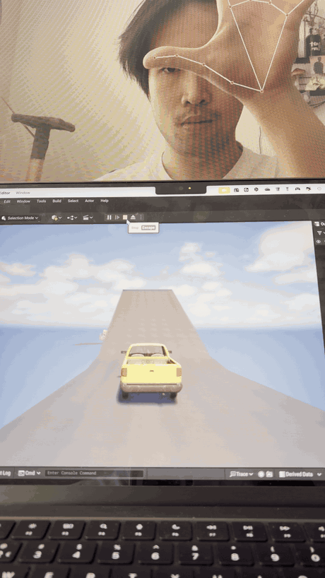
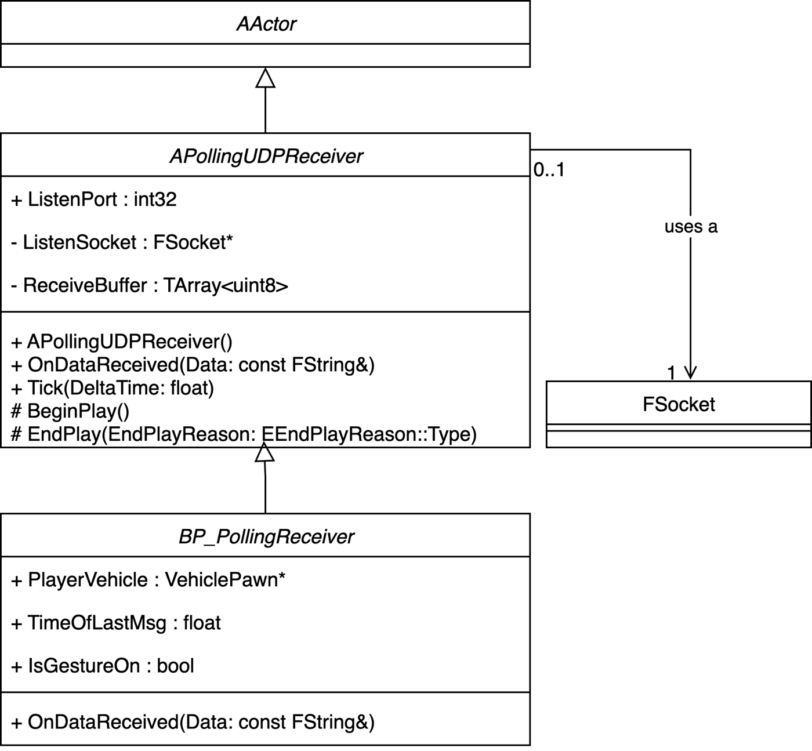
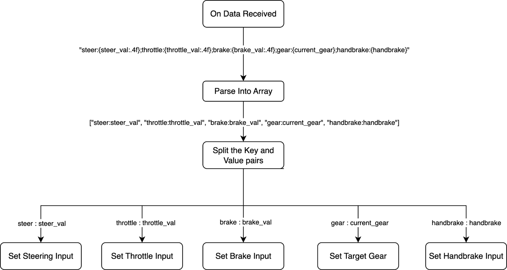
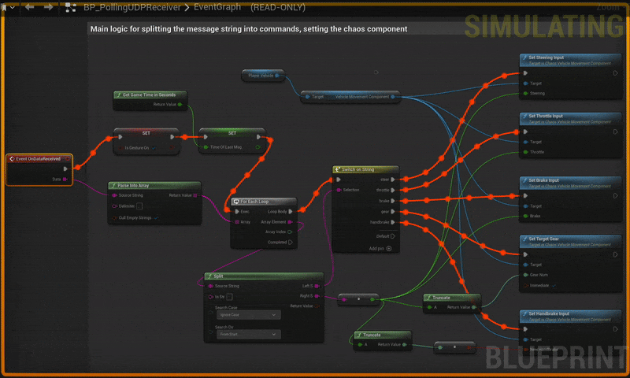
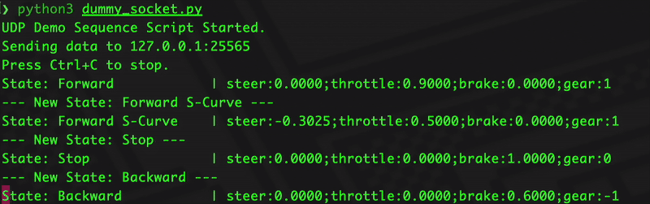
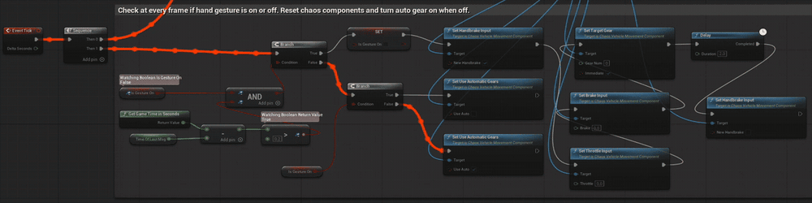

# Gesture-Controlled Vehicle in Unreal Engine 5

In summer semester 2025, five of us built a driving game in Unreal Engine 5 that you control with your hands in front of a webcam. It was an institute project in agile development at RWTH Aachen. I wrote the gesture control and the connection to Unreal: the Python program that turns hand poses into driving commands, the UDP bridge, and the vehicle control on the Unreal side.



This repository contains my code only. The full Unreal project isn't included: it is about 5 GB, and some of its assets come from a store pack (Vehicle Variety Pack) whose licence doesn't allow redistributing it.

## How it works

```
webcam ─▶ gesture_control.py (MediaPipe: 21 landmarks per hand ─▶ steer, throttle, brake, gear, handbrake)
                │
                │  UDP to localhost:25565, one message per camera frame
                │  "steer:0.1250;throttle:0.8000;brake:0.0000;gear:1;handbrake:0.0"
                ▼
Unreal Engine 5: APollingUDPReceiver (C++) ─▶ OnDataReceived (Blueprint) ─▶ Chaos vehicle input
```

I chose UDP because it is simple and has very low latency, and a lost packet doesn't matter when the next frame replaces it anyway. I wrote my own receiver in C++ because the UDP plugins I found for Unreal were either paid or didn't run on Apple Silicon.

## Gestures

| Hand | Gesture | Effect |
|---|---|---|
| Right | Move left or right | Steering, from the wrist's horizontal position |
| Right | Open or close | Throttle when open, brake when closed, coasting in between |
| Right | Fist | Handbrake |
| Left | Thumb up / thumb down | Drive / reverse (with a short delay so it doesn't flicker) |
| Both | T-shape | Pause gesture control and hand over to the keyboard |
| Both | OK sign with both hands | Resume gesture control |

Openness is the distance between thumb tip and little-finger tip divided by the width of the palm, so it doesn't change when you move your hand closer to or further from the camera.

## Unreal side

The receiver is split into two layers. `APollingUDPReceiver` (C++, derived from `AActor`) only receives data: it opens a non-blocking socket on `BeginPlay` and reads every waiting packet in `Tick`. Its Blueprint child `BP_PollingReceiver` holds the control logic.



When a message arrives, the Blueprint splits it at `;` into commands and each command at `:` into key and value. It then passes each value to the matching function on the player's vehicle: Set Steering Input, Set Throttle Input, Set Brake Input, Set Target Gear and Set Handbrake Input. The vehicle reference is refreshed every tick from the player controller.





## Testing without the camera

Before the gesture recognition was ready, I tested the whole Unreal side with `udp_test_sender.py`. It replays a scripted drive (forward, S-curve, stop, reverse) in the same message format. Watching the data flow in the Blueprint debugger also showed how each command combination moves the car. For example, in reverse the brake value acts as throttle, so the throttle has to stay at zero.



## Bugs found during integration

Two problems only showed up once the real Python script was connected:

- **The car kept driving when the script stopped.** Now the Blueprint checks on every tick how long ago the last message arrived. After a short timeout it resets all inputs, so the car stops, and switches gesture control off. This works as a dead man's switch.
- **Gestures and the keyboard fought over the car.** A public flag `IsGestureOn` on the receiver now blocks the vehicle's keyboard events while gesture messages are arriving, and gives control back to the keyboard on timeout or after the T-shape pause gesture.



## Files

| File | What it does |
|---|---|
| [`python/gesture_control.py`](python/gesture_control.py) | Reads the webcam, runs MediaPipe hand tracking, maps both hands to the controls above and sends them over UDP. Shows the current values in the camera window. |
| [`unreal/PollingUDPReceiver.h`](unreal/PollingUDPReceiver.h), [`.cpp`](unreal/PollingUDPReceiver.cpp) | The C++ receiver actor. `Tick` runs on the game thread, so the Blueprint event can apply the values to the car directly, without any thread handling. |
| [`python/udp_test_sender.py`](python/udp_test_sender.py) | Replays a scripted drive at 60 Hz in the same message format. |

The Blueprint itself is a binary Unreal asset, so it isn't included. The images above show its logic.

## Running it

1. **Unreal:** copy the two receiver files into your project's `Source/<Module>/` folder and replace `TEST_UNREAL_API` with your module's API macro. Add `"Sockets"` and `"Networking"` to `PublicDependencyModuleNames` in `<Module>.Build.cs`. Create a Blueprint child of `PollingUDPReceiver` whose `OnDataReceived` splits the string at `;` and `:` and passes the values to the vehicle movement component. Then start the game.
2. **Python** (tested with Python 3.11):
   ```bash
   cd python
   python3 -m venv venv && source venv/bin/activate
   pip install -r requirements.txt
   python gesture_control.py      # or: python udp_test_sender.py
   ```
   Press `q` in the camera window to quit.

## Team

Built with Maksim, Tobin, Philipp and Fabrice. The game levels and the local multiplayer are their work and aren't part of this repository.
