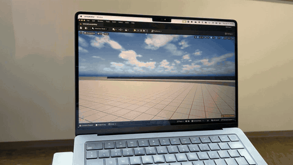

# Gesture-Controlled Vehicle in Unreal Engine 5

In summer semester 2025, five of us built a driving game in Unreal Engine 5 that you control with your hands in front of a webcam. It was an institute project in agile development at RWTH Aachen. I wrote the gesture control and the connection to Unreal: the Python program that turns hand poses into driving commands, the UDP bridge, and the vehicle control on the Unreal side.



This repository contains my code only. The full Unreal project isn't included: it is about 5 GB, and some of its assets come from a store pack (Vehicle Variety Pack) whose licence doesn't allow redistributing it.

## How it works

```
webcam ─▶ gesture_control.py (MediaPipe: 21 landmarks per hand ─▶ steer, throttle, brake, gear, handbrake)
                │
                │  UDP to localhost:25565, one message per camera frame
                │  "steer:0.1250;throttle:0.8000;brake:0.0000;gear:1;handbrake:0.0"
                ▼
Unreal Engine 5: APollingUDPReceiver (C++) ─▶ OnDataReceived (Blueprint) ─▶ Chaos vehicle input
```

## Gestures

| Hand | Gesture | Effect |
|---|---|---|
| Right | Move left or right | Steering, from the wrist's horizontal position |
| Right | Open or close | Throttle when open, brake when closed, coasting in between |
| Right | Fist | Handbrake |
| Left | Thumb up / thumb down | Drive / reverse (with a short delay so it doesn't flicker) |
| Both | T-shape | Pause |
| Both | OK sign with both hands | Resume |

Openness is the distance between thumb tip and little-finger tip divided by the width of the palm, so it doesn't change when you move your hand closer to or further from the camera.

## Files

| File | What it does |
|---|---|
| [`python/gesture_control.py`](python/gesture_control.py) | Reads the webcam, runs MediaPipe hand tracking, maps both hands to the controls above and sends them over UDP. Shows the current values in the camera window. |
| [`unreal/PollingUDPReceiver.h`](unreal/PollingUDPReceiver.h), [`.cpp`](unreal/PollingUDPReceiver.cpp) | An Unreal actor that opens a non-blocking UDP socket on `BeginPlay` and reads every waiting packet in `Tick`. Each message goes to the Blueprint event `OnDataReceived`. `Tick` runs on the game thread, so the Blueprint can apply the values to the car directly, without any thread handling. |
| [`python/udp_test_sender.py`](python/udp_test_sender.py) | Replays a scripted drive (forward, S-curve, stop, reverse) at 60 Hz in the same format, to test the Unreal side without a camera. |

## Running it

1. **Unreal:** copy the two receiver files into your project's `Source/<Module>/` folder and replace `TEST_UNREAL_API` with your module's API macro. Add `"Sockets"` and `"Networking"` to `PublicDependencyModuleNames` in `<Module>.Build.cs`. Create a Blueprint child of `PollingUDPReceiver` whose `OnDataReceived` splits the string at `;` and `:` and passes the values to the vehicle movement component. Then start the game.
2. **Python** (tested with Python 3.11):
   ```bash
   cd python
   python3 -m venv venv && source venv/bin/activate
   pip install -r requirements.txt
   python gesture_control.py      # or: python udp_test_sender.py
   ```
   Press `q` in the camera window to quit.

## Team

Built with Maksim, Tobin, Philipp and Fabrice. The game levels and the local multiplayer are their work and aren't part of this repository.
